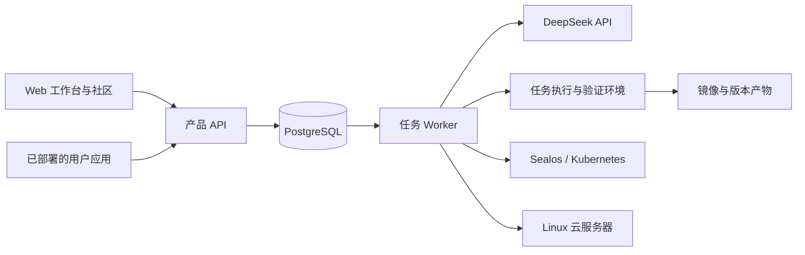

# IntelliDeploy 一期技术设计草案

日期：2026-11-09

状态：整体设计已确认；2026-11-10 明确恢复一期 A/B/C/D 四路线及优先检索复用，D 限定成熟 Next.js/TypeScript/PostgreSQL/Prisma 脚手架。本文不表示代码已完成。

产品依据：[PRD](../../PRD.md)

## 1. 设计目标与明确约束

交付真实可用的个人及多人 Web 应用，支持四条自动实现路径、继续对话调整、社区共享和独立副本。部署到平台已准备好的 Sealos 或普通 Linux 服务器。

模型直接调用 DeepSeek 官方 API。平台实现必要的工具执行和状态保存，不将 Codex SDK、Claude Agent SDK、LangGraph 或多智能体投票作为一期依赖。

允许重构现有代码和技术栈。保留有实际价值且通过验证的检索、仓库读取、产物校验、构建和部署逻辑；代码复用不能影响新流程的一致性。

主要约束是结果正确、数据保留、执行费用受控，以及在不同运行目标上的可交付性。速度通过复用已验证版本、合理选路和后台执行改善。

## 2. 建议技术栈与进程边界

| 部分 | 建议 | 原因 |
| --- | --- | --- |
| 平台 Web | Next.js + TypeScript + Tailwind | 公开社区页可服务端渲染；应用工作台适合交互式页面。可复用现有视觉素材 |
| 产品 API | FastAPI + Pydantic + SQLAlchemy | 保留现有后端语言与可用模块，统一接口和数据模型 |
| 任务 Worker | 同一 Python 项目的独立进程 | 长任务与 HTTP 请求分开；避免请求进程内 create_task 充当队列 |
| 状态及队列 | PostgreSQL | 业务状态、事件、额度账本和任务租约持久保存；一期无需额外引入队列服务 |
| 模型 | OpenAI Python SDK 的异步客户端，调用 DeepSeek | 复用标准客户端；实现显式的工具循环和协议处理 |
| 代码执行 | 专用执行节点上的独立受限环境 | 每次任务有自己的工作区、进程和资源限额，与产品控制面分离 |
| 浏览器验证 | Playwright | 验证实际页面交互、登录和数据保存，提供截图和失败证据 |
| 镜像构建 | 独立构建环境，默认考虑 BuildKit | 统一镜像产物；现有 Kaniko 实现经过验证后可用于 Sealos 构建目标 |
| 部署 | Kubernetes 与 Linux 容器部署两种实现 | 普通云服务器按运行环境适配，避免逐云厂商重写 |

平台前端使用 Next.js，平台后端使用 FastAPI/Python。A/B/C 保留候选项目的合理栈和依赖；D 的默认成熟脚手架固定为 Next.js + TypeScript + PostgreSQL + Prisma，并锁定已验证依赖。

首期只有 Web、API、Worker 三类业务进程，同仓库管理。部署、模型、文件和身份能力首先作为后端模块，不拆成独立微服务。构建和代码执行环境因任务隔离需要单独运行。

## 3. 统一的任务与四条路径

使用明确名称，避免和旧 ABCD 枚举混淆：

- A / DEPLOY_EXISTING：现成应用部署。
- B / MODIFY_EXISTING：单仓库改造。
- C / COMPOSE_COMPONENTS：多仓库或组件整合。
- D / GENERATE_APP：成熟 Next.js/TypeScript/PostgreSQL/Prisma 脚手架生成。

WAITING_USER、PAUSED_QUOTA、FAILED 是执行状态，不是额外产品路径。

处理过程：需求澄清 → 保存验收清单 → 检索与阅读材料 → 选路与执行计划 → 准备工作区 → 实现 → 验证 → 构建 → 部署 → 实际访问验收 → 发布版本。

首先比较候选的功能覆盖、预计变更范围、依赖及部署条件。Stars 和更新时间提供质量信号，不替代需求匹配。组件整合和直接生成比较真实整合成本，不采用“功能多就拼接”的固定规则。

路由输出保存所选路径、候选代码、关键缺口、理由、计划和执行预算。只使用实际候选和已读取材料；库不存在、关键文件缺失、README 过期等情况需要记录证据。

默认检索复用优先；A 满足核心需求且适合部署时不直接改走 D。检索至少覆盖业务关键词、英文及同义表达/应用类别，抓取必要候选证据；限流、超时和资料读取失败须重试或明确报可重试故障，不能作为 D 的依据。获得新证据后允许换仓库或路径。默认每个生成任务最多两次路线切换；同一失败检查最多三轮无实质进展的修复。工作有进展时仍受总预算限制。以上数字为初始配置建议，可按验收样本调整。

四条路径都保留原始来源和使用版本。整合多个组件时，记录各组件入口、接口、数据归属、依赖和集成验证。D 只使用成熟 Next.js/TypeScript/PostgreSQL/Prisma 脚手架，预接账号、数据、文件、AI 和搜索；不能把固定占位逻辑当完整业务。框架和依赖版本锁定，生成和调整都做真实验证。

任务状态与阶段分开：Job.status 使用 QUEUED、RUNNING、WAITING_USER、PAUSED_QUOTA、SUCCEEDED、FAILED、CANCELLED；Job.phase 描述澄清、检索、实现、验证、构建、部署或实际访问验收。生成和调整任务只有在核心验收通过且对应版本实际发布后才能 SUCCEEDED。创建副本任务也需要新实例的实际部署验收。

Instance.status 独立描述 PENDING、DEPLOYING、RUNNING、STOPPED、FAILED、DELETING、DELETED。应用运行状态、任务完成状态与社区公开状态分别管理：调整失败时旧实例可以继续 RUNNING，停止运行不等于删除软件或数据，取消公开不等于删除应用。

### 检索质量与评分门槛

采用多查询 GitHub 召回、已有验证项目/README 召回、候选资料补全和证据评分。搜索默认不强制 Next.js，不设统一高星门槛或一年更新时间硬淘汰；具体兼容性以候选的真实依赖和运行验证为依据。

评分初始建议：需求匹配 60%、部署可行 25%、工程质量 15%，配置和版本留存。每个维度保存证据、缺失核心功能、未知信息和预计改造/整合工作。权重用于排序，不是经过训练的成功率。

A 要求核心需求覆盖、候选信息足够且部署可行；缺功能进入 B/C 可行性评估。只有完成合理查询覆盖且复用方案不合适时才可 D。D 决策记录被考虑的 A/B/C 方案及否决原因；搜索服务故障时禁止用空结果直接生成。

原检索中的低星、少更新、归档标记作为质量信号评估，不直接替代源码和可运行性证据。框架/库不能当完整应用推荐，但可作为 B/C 的组件来源。检索回归以真实需求和已知适合仓库验证召回、排序及路线选择。

## 4. DeepSeek 接入及工具循环

统一客户端使用 https://api.deepseek.com，优先 Chat Completions + Tool Calls。身份和模型 Key 由平台服务端管理。

初始建议使用 deepseek-flash 处理常规任务；复杂改造或连续修复效果不足时可以切换 deepseek-v4-pro。模型选择和思考强度由任务策略控制，实际切换规则根据样本评测制定。Flash 的图像能力可以辅助截图检查；所有视觉判断仍需结合页面和接口验证。

工具循环的最小职责：

1. 从持久状态恢复当前需求、计划、源码版本和必要对话。
2. 发送 DeepSeek 请求，记录返回的文本、工具请求和用量。
3. 验证工具名、参数及任务权限后，在该任务环境执行。
4. 保存工具调用、输出和结果；按协议把匹配的工具结果传回模型。
5. 循环到本轮结束、需用户回答、额度暂停、执行限制或故障。

完整保存协议需要的思考内容和工具调用字段；不丢弃思考模式下后续请求需要的 reasoning_content，也不将其暴露到用户页面。上下文摘要另行保存，不能用摘要替代工具调用必须的对应结果。

内存不是唯一状态来源。保存需求、验收项、执行计划、当前版本、工具事件、工作区引用和会话检查点。上下文过长时保留目标、验收状态、当前失败证据及最近相关操作，对历史结果做摘要；没有实际证据的判断不能写成已通过。

工具首先以明确函数实现：list_files、read_file、write_file、apply_patch、run_command、search_repositories、fetch_repository、web_search、fetch_page、run_browser_check。工具注册表足够，不建设通用插件市场或专家模型矩阵。

发布、计费结算和资源删除由后端按确定规则执行。模型产物必须通过校验，不能直接成为平台侧任意操作命令。

## 5. 执行环境与持久任务

每个任务在独立工作区中运行。源码目录、依赖缓存、持久产物和任务状态分开管理，记录工具产生的文件变更。

运行命令时限定工作目录、超时、输出大小、CPU、内存和磁盘用量。执行环境不持有平台数据库管理凭据、云部署凭据或共享模型 Key；平台工具代理提供任务所需的有限访问。执行节点与产品 API 的机器或运行边界分开，不能让项目代码访问控制面或宿主容器管理接口。

单个任务可由模型顺序执行多个步骤；确定性且相互独立的抓取或检查可以由程序并发。首期不默认并发启动多个模型修复并争抢同一应用状态。

PostgreSQL 的 jobs 表保存任务阶段、租约、重试、预算、检查点和终态。Worker 以事务和 FOR UPDATE SKIP LOCKED 认领，定期续约。租约过期由恢复逻辑重新认领。

恢复时优先核对已完成的外部动作：镜像是否已构建、版本是否已部署、费用是否已结算。每个关键动作使用唯一操作 ID，避免重启导致重复构建、部署或扣费。已计费但无法确认结果的模型请求记录为不确定状态，不能盲目重放后再次向用户收取同一动作费用。

默认每个应用只有一个活跃的修改或发布任务。新消息在当前任务检查点处理或进入队列，避免两个任务同时改同一源码、数据结构和线上版本。

## 6. 验证与发布

验收清单在实现前保存，描述用户可观察的结果。Agent 可以补充测试，但核心标准不能在实现失败后被自动降低。

验证分五层：

1. 结构：依赖锁、入口、配置、环境变量、持久目录、构建清单。
2. 运行：实际安装依赖、构建、启动，检查进程和错误日志。
3. 接口：核心接口、权限、数据保存和真实平台能力调用。
4. 页面：Playwright 执行关键用户操作、刷新和重访，保存结果与截图。
5. 部署：真实地址的可访问性及部署后的核心操作。

验证结果保存 PASS / FAIL / NOT_RUN 及证据。完整交付需要核心验收项全部 PASS；截图漂亮、容器存活或一个 200 响应不能替代业务验证。校验脚本在受控环境中执行，关键验证可以由平台确定性的检查再次核对。

真实集成验证使用独立测试数据并记录成本，完成后清理测试数据。不能把测试账号、示例记录或 demo-token 留作用户的生产数据或认证实现。

AppVersion 表示不可变的发布材料：源码快照、来源版本、镜像摘要、运行清单、验收清单和验证报告。已发布版本指向验证通过的 AppVersion。

修改先创建候选版本，验证后在同一实例发布。运行服务自动重启属于一期底座。持久数据不打包进源码镜像，不在每次发布时初始化覆盖。

数据迁移先在数据副本或验证环境测试，对发布相关数据生成必要的恢复材料；不承诺所有数据库迁移可以通过切回镜像恢复。无法保留数据的迁移阻止自动发布并保存诊断，不能偷偷清空数据。持续备份和恢复服务另属二期。

## 7. 应用清单与两种部署实现

交付材料包含源码快照、依赖锁、每个服务的镜像、AppManifest 和验证报告。

AppManifest 最小包含：清单版本、Web 入口服务、服务列表、端口、环境变量引用、服务依赖、健康检查、资源需求、持久卷和数据迁移指令。允许前端、后端、数据库或缓存等多个服务；每项必须有实际运行依据。

平台默认提供 PostgreSQL 数据空间。既有仓库需要 MySQL、MongoDB、Redis 等时，按真实依赖生成伴生服务或接入平台已配置的对应资源；不通过错误替换数据库实现来冒充直接部署。

部署模块先用 deploy_kubernetes 和 deploy_linux 两个具体实现，共用任务、版本、资源及验收记录。新增云厂商的普通 Linux 主机只增加部署目标配置；托管 Kubernetes 按集群能力校验。

| 目标 | 发布方式 | 持久化与访问 |
| --- | --- | --- |
| Sealos / Kubernetes | 将清单转为 Deployment、Service、Ingress、Secret 等资源 | 持久卷或外部数据服务；平台控制域名和 TLS |
| 普通 Linux | SSH 或受控部署代理发布容器服务，生成 Compose 配置 | 固定数据卷、资源限制、自动重启；反向代理及 TLS |

服务器与集群在执行前登记、校验。平台负责预先提供可用主机、域名解析、镜像仓库和必要的网络访问；系统不自动购买服务器。

镜像构建在独立环境执行，应用执行工作区不挂载宿主 Docker socket。构建产物推送平台配置的镜像仓库，Linux 和集群均拉取同一版本。

部署操作以 app、instance、version 为单位保存幂等记录。失败有明确阶段并回传证据；修复胜出后进入同一个状态转换，外层原始异常不能重新覆盖成功状态。

## 8. 平台身份、数据及能力接入

App 是可修改的软件项目；AppVersion 是软件版本；Instance 是一个独立运行和数据空间；Publication 是社区公开页。这四个概念分开保存。

平台用户在不同应用中具有应用范围内的身份。新增或生成应用优先通过标准身份接入获得该身份；既有仓库自带账号系统时，需要明确映射、适配及实际验证，不假设所有账号系统能无改动统一。

业务数据由具体应用负责，实例有独立数据库或数据空间及最小范围的凭据。文件按实例和访问权限管理。实例之间默认不共享数据。

AI 和联网搜索通过平台能力模块调用，凭应用实例授权和用户身份校验确定付费方。匿名赞助调用只在发布者允许的范围内运行，不能仅凭客户端传来的付费方参数扣费。

平台共享的 DeepSeek Key 留在能力模块。应用和 Agent 获得的是限定到实例或任务的访问凭据；用户应用的服务端请求走平台 API，浏览器不直接携带平台模型 Key。

联网搜索初始直接接 DeepSeek Search 与 Fetch API：POST /v1/tools/search、POST /v1/tools/fetch。该能力不依赖模型内置搜索是否可用，结果包含来源，工具调用和成功请求数单独记录。

源代码修改是否需要嵌入身份、AI 或存储接入，按应用的真实结构判断。部署入口对应用提供基础访问控制，应用内仍需要正确业务权限；网关登录不能代替应用内部的数据隔离。

## 9. 社区共享、独立副本及额度

发布者选择一个通过验收的版本发布到社区，可以更新公开版本，也可以取消公开。访问公开页不要求登录；进入私有功能或消费个人额度时使用统一的平台身份。

直接使用关联发布者的同一 Instance。共享应用按发布配置使用 SPONSOR 或 VISITOR 付费策略：

- SPONSOR：调用由发布者的额度账户承担，受发布者总预算和访客用量限制。
- VISITOR：调用者需要平台身份并使用自己的额度。

基础运行与存储用量归实例拥有者。此规则是费用归属建议，供整体评审；与二期作者定价和收益分成分开。

创建副本固定引用所选 AppVersion，复制软件材料、创建独立 Instance、重新生成凭据并部署。生产私有数据、用户、文件、第三方账号凭据都不复制。仅源码中明确标记的公开初始化资料可以作为新应用的初始内容。

免费、订阅和购买额度以具有来源、有效期和余额的 grants 记录；先使用最早过期的可用额度，无到期时间的购买额度排后。使用整数表示最小额度单位，价格规则有版本，模型输入、缓存输入、输出、搜索、构建和运行资源分别计量。

生成任务启动时按预算预留额度，实际用量逐次记账，完成后释放剩余额度。账本追加记录，使用操作 ID 防止重复；返还通过反向记录实现。价格、套餐和免费额度为运营配置，不写死在 Agent Prompt 中。

PAUSED_QUOTA 状态保存检查点；补足额度后由用户选择继续。任务启动页告知用量规则，应用消费时按发布策略执行。未收到上游用量信息时不能编造数字，先记录待核对事件。

用户在实施计划阶段补充确认：一期支持支付宝、微信支付和 Stripe，先实现额度/套餐/用量再接收款。三种渠道共用服务端订单与额度账本；校验供应商签名、订单、金额和币种，按支付或套餐周期唯一入账。浏览器成功页不能发放额度。此处平台收款与二期创作者变现分开。

## 10. 主要数据与接口

核心数据：User、App、Conversation、Requirement、AcceptanceItem、AppVersion、Instance、Publication、Job、JobEvent、ToolCall、DeploymentAttempt、CapabilityCall、QuotaGrant、UsageEntry、QuotaReservation。均由同一产品后端管理；模型字段必须携带实际来源或证据引用。

建议 API 主线：

- POST /api/apps：输入需求，创建应用与初始对话。
- POST /api/apps/{id}/messages：继续需求澄清或调整。
- GET /api/apps/{id}：当前需求、任务、版本和实例状态。
- GET /api/jobs/{id}/events：SSE 事件，支持断线后按事件 ID 补发。
- POST /api/apps/{id}/publish：发布验证通过的版本。
- GET /api/community/apps：公开应用目录。
- POST /api/publications/{id}/copies：创建独立副本。
- POST /api/instances/{id}/stop：停止运行，保留数据。
- DELETE /api/instances/{id}：用户确认后删除指定实例及选定数据。
- /api/capabilities/*：身份、文件、AI、搜索等能力接口。
- /api/quota/*：额度、套餐、用量及购买记录。

实际接口 Schema 在实施计划中按子系统细化。一个接口不能根据入口不同隐式选择“真实部署”或“模拟成功”。开发演示使用独立测试记录，不写入真实交付状态。

用户消息和任务事件持久保存。前端可刷新恢复，SSE 断线补发；UI 展示简明业务状态。页面交互不依赖只有内存中的 WebSocket 历史。

## 11. 失败与暂停

| 情况 | 处理 |
| --- | --- |
| 业务信息不足 | WAITING_USER，提出具体且少量的业务问题 |
| 仓库不足或无法改造 | 在预算内换候选、换路径；保留选择证据 |
| 构建或业务验证失败 | 回传具体证据修复；超过限制明确 FAILED |
| 额度不足 | PAUSED_QUOTA；保存进度，补额度后可继续 |
| 模型超时或限流 | 有界重试及退避，不把错误当模型输出 |
| 部署失败 | 保存目标、日志和操作状态；修复后重新验证 |
| Worker 中断 | 租约恢复，核对外部动作和检查点，避免重复扣费 |
| 新版本无法保留数据 | 阻止发布，旧版本继续运行，显示调整失败 |

复杂任务有管理员配置的墙钟时间、模型费用、工具次数和运行资源上限。产品不固定承诺统一耗时。重复错误检测和路线切换上限提供初始保护，实际预算通过成本评测配置。

## 12. 现有仓库的处理建议

- 检索：复用 GitHub 请求、候选合并和有价值的评分规则；接通实际 README 语料，修复中文分词，建立真实需求样本。
- 仓库提取：复用关键文件和锁文件识别；Agent 可以按需继续读取源码，不能只凭目录猜实现。
- fallback：保留经过实际验证的模板和确定性校验；把占位生成器替换成真实工具执行。
- 部署：提取已有 K8s、镜像和 Sealos 中可用逻辑，统一发布状态；补 Linux 实现。
- 状态：合并旧 RAG 与 NL 部署入口；移除把进程内字典作为唯一任务结果来源的做法。
- 数据：采用正式数据库迁移；旧 SQLite 有 11 个缺失部署字段，不依靠 create_all 升级。
- 前端：保留设计资产和可用页面思路，围绕对话、我的应用、交付与社区重做流程。
- Prompt：保留有价值的要求和样例；不要求生成一定经过多智能体投票或产生固定数量阶段。

旧实现迁移时逐项通过新验收场景，再移除重复入口。历史日志、旧账号和有效业务数据是否迁移在实施前核对，不能直接清空现有数据库。

## 13. 按验收节点推进

下面是交付顺序建议，不是日期承诺，也不是最终实施计划：

1. 最小真实闭环：需求、工具调用、隔离工作区、真实启动检查、已有 Linux 目标部署、持久任务恢复。
2. 四条路径：每条都有真实应用样本，包括源码改造、跨组件业务打通及完整生成。
3. 平台能力与多人数据：身份、数据、文件、AI、搜索、权限验证及持续调整。
4. 版本与多云：候选版本验证、数据迁移保护、Sealos 与 Linux 两类部署验收。
5. 社区：发布、匿名体验、按需登录、同一实例使用及独立副本。
6. 收费：额度来源、预留结算、套餐和购买、赞助或访客策略；早期节点先落用量记录，真实商业试用前完成收费闭环。

首期交付包括 A/B/C/D 和全部其他节点。D 的技术栈限定只用于直接生成，不能删掉一期检索或现成部署路径。内部可以分批验证，但不能将未实现路径对外描述为已支持。

## 14. 必须通过的故障与业务检查

- 四条路径各完成一例真实业务应用，并保存操作证据。
- 多人应用中，用户 A 无法读取用户 B 的私有数据。
- AI 和联网搜索进行真实调用；没有权限或额度时明确失败或暂停。
- 应用服务重启后数据库记录和上传文件仍存在。
- 用户继续对话后核心改动可用，失败候选版本不替换线上版本。
- 社区独立副本运行正常，不含原应用的私有数据和凭据。
- 同一应用版本分别部署到 Linux 和 Sealos，访问及核心操作都通过。
- 杀死 Worker 后，任务可恢复或明确结束；生成结果和已完成发布不会只存在内存中。
- 同一模型、部署或计费动作重放不会造成同一动作重复扣费。
- 构建失败后自愈通过，最终状态保持成功；全失败时不产生虚假访问地址。
- 搜索无结果、模型限流、额度不足、迁移失败分别有确定状态和可理解的用户提示。

具体代表仓库在实施时固定提交版本，并保存选择原因；不得用外部仓库的最新变化使验收结果不可复现。DeepSeek 对复杂改造的能力与单次费用需要真实样本测量，本草案不承诺未测成功率。

## 15. 已核对的官方资料

2026-11-09 核对：

- [DeepSeek API 格式与模型](https://api-docs.deepseek.com/)
- [工具调用与思考模式](https://api-docs.deepseek.com/guides/tool_calls)
- [DeepSeek Search / Fetch](https://api-docs.deepseek.com/guides/search)
- [Responses 兼容详情](https://api-docs.deepseek.com/guides/responses_api/)

官方接口能力已核对，真实项目接入和验收尚未执行。模型名称、价格和限额应作为配置并在接入时复核。

## 16. 实施入口

设计已确认：[一期实施总计划](../plans/2026-11-09-phase1-00-roadmap.md)。生成、交付、平台能力、社区及支付按独立任务验收。
