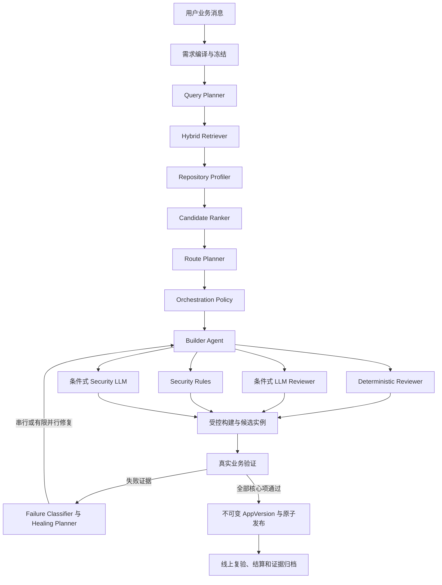

# IntelliDeploy Phase 1 算法融合设计

日期：2026-11-12

状态：书面规格已获批准，可以进入实施计划；本文不表示实现已经开始或真实外部验收已经通过。

关联文档：

- [产品需求](../../PRD.md)
- [一期技术设计](2026-11-09-intellideploy-phase1-design.md)
- [一期实施总计划](../plans/2026-11-09-phase1-00-roadmap.md)
- [一期实施进度](../../一期实施进度.md)
- [原检索召回设计](../../algorithm/检索召回.md)
- [原评估生成设计](../../algorithm/评估生成.md)
- [原部署自愈设计](../../algorithm/部署自愈.md)
- [原多智能体设计](../../algorithm/多智能体.md)

## 1. 背景与结论

Phase 1 已建立正确的生产交付骨架：持久需求和任务、独立 Worker、租约与检查点、受控 runner、候选实例、业务验证、不可变版本、Linux/Kubernetes 发布、数据保护、计费和真实证据门槛。该骨架继续作为唯一产品主链。

Phase 1 当前算法实现则弱化了原设计中有价值的查询改写、混合召回、仓库事实提取、候选重排、技术栈确定性规则和条件式并行自愈。当前通用单 Agent 工具循环能够实现代码，但不足以独立承担产品的全部智能决策。

本设计采用动态融合方案：

1. 保留 Phase 1 生产骨架及其所有安全、恢复、计费和验收边界。
2. 恢复并升级原算法中的检索、仓库理解、评分和故障策略能力。
3. 保留一个主 Builder；确定性 Reviewer 和安全规则始终执行。
4. LLM Reviewer、Security LLM 和并行自愈仅按路线、复杂度、风险或失败证据触发。
5. 最终交付成功只能由真实业务验收和线上复验确定，任何 Agent 都不能自行批准发布。

本设计不恢复旧运行架构，不重新挂载旧 RAG/NL/fallback/multi-agent API，不让旧 Celery/Redis 状态成为任务事实源，也不把 LangGraph 设为一期强制依赖。

## 2. 产品判断

原算法架构主要围绕“检索 GitHub 仓库、生成部署配置、部署和日志自愈”，适合 AI GitHub 项目部署与自愈产品。Phase 1 的产品目标更大：用户通过自然语言获得可持续修改、可托管、可分享和可计费的真实 Web 应用。

因此，原架构不能整体替换 Phase 1；正确目标是给 Phase 1 生产骨架恢复算法大脑。融合后需要同时满足：

- 检索和选路有可审计证据；
- Agent 能实现和修复业务代码；
- Reviewer 不与 Builder 共用批准权；
- 安全依赖隔离和确定性规则，LLM 仅补充；
- 用户需求、私有数据、持久化和线上行为有真实验证；
- 算法增强不能破坏任务恢复、预算幂等和发布原子性；
- 增强算法必须以 Baseline/Hybrid 对照证明收益后才能成为默认。

## 3. 目标与非目标

### 3.1 目标

- 将原 Router、双路召回、仓库事实探测和候选重排迁入 Phase 1 主链。
- 以证据驱动 A/B/C/D 产品路线，而不是让模型任意选择。
- 为不同路线和风险动态选择 Reviewer、Security LLM 和 Healing 策略。
- 在昂贵构建前发现需求、入口、依赖、权限和安全问题。
- 减少错误仓库、错误路线和无效构建造成的总交付时间及费用。
- 保持所有模型、工具、构建、候选和发布动作可恢复、可计量和可审计。
- 以真实需求、固定来源和同等预算对照当前 Baseline 与 Hybrid。

### 3.2 非目标

- 不恢复 LangGraph 作为强制运行依赖。
- 不让每个任务固定经过 Builder、Reviewer、Security 三 Agent 投票。
- 不训练或自研专用模型。
- 不建立通用 Agent 插件市场。
- 不承诺未经真实样本证明的 95% 成功率或统一交付时间。
- 不扩展到任意 GPU、Windows、桌面或原生应用生成。
- 不自动购买云资源。
- 不允许模型决定总预算、重试上限或工具权限。
- 不用 LLM Review 替代真实测试。
- 不把 Shadow、forced、fixture 或协议联调记为真实交付。
- 不在 DeepSeek、runner、registry 和真实目标未准备时切换默认 Hybrid。

## 4. 总体架构



架构边界：

- 算法层负责理解、检索、评价、选路和修复策略，不直接宣告成功。
- Builder 负责实现，但不能批准自己的结果。
- Reviewer 输出可追溯 Finding，不直接修改 Job 终态。
- Security LLM 是补充，runner 隔离、权限、网络、凭据和确定性规则是安全根基。
- Phase 1 Worker、runner、runtime、账本和发布模块继续拥有所有外部副作用。
- 所有阶段绑定需求 revision、来源 commit、attempt、manifest hash 和算法版本。

## 5. 统一算法契约

本节示例共同使用以下值对象；实现时字段名和语义保持一致，不能退化为无结构 `dict`：

```python
class EvidenceRef(BaseModel):
    kind: Literal["REPOSITORY", "PROFILE", "REVIEW", "VALIDATION", "SECURITY"]
    reference: str
    digest: str
    access: Literal["PRIVATE", "OWNER", "DEVELOPER"]

class EnvRequirement(BaseModel):
    name: str
    required: bool
    source_ref: str
    secret: bool

class Finding(BaseModel):
    code: str
    message: str
    severity: Literal["BLOCKING", "WARNING", "INFO"]
    evidence_ref: str

RouteName = Literal[
    "DEPLOY_EXISTING", "MODIFY_EXISTING",
    "COMPOSE_COMPONENTS", "GENERATE_APP"
]

class RouteStep(BaseModel):
    kind: str
    source_roles: list[str]
    acceptance_ids: list[str]

class RouteRejection(BaseModel):
    route: RouteName
    reason: str
    evidence_refs: list[str]
```

### 5.1 AlgorithmCheckpoint

新增有版本的算法检查点，作为新任务唯一算法状态来源：

```python
class AlgorithmCheckpoint(BaseModel):
    schema_version: Literal[1]
    requirement_revision: int
    query_plan: QueryPlan | None
    retrieval: RetrievalResult | None
    profiles: list[RepositoryProfile]
    evaluations: list[CandidateEvaluation]
    route: RoutePlan | None
    orchestration: OrchestrationDecision | None
    reviews: list[ReviewReport]
    healing: list[HealingDecision]
    selected_sources: list[RepoSource]
    evidence_refs: list[EvidenceRef]
    stages: list[AlgorithmStageRecord]
```

存入 `job.checkpoint["algorithm"]`。新任务不双写多份影子状态；旧任务的 `retrieval/evaluations/route/loop` 由只读兼容器转换。大段 README、源码和扫描结果不进入 JSONB，只保存摘要、hash 和受保护证据引用。

### 5.2 QueryPlan

```python
class QueryPlan(BaseModel):
    original: str
    github_queries: list[str]
    readme_queries: list[str]
    translated_terms: list[str]
    categories: list[str]
    required_capabilities: list[str]
    constraints: dict[str, str]
```

Query Planner 继承原 Router 的结构化意图和查询扩展能力。模型不可用时可以使用确定性扩展，但必须标记完整度，不能声称查询已完整覆盖。

### 5.3 RetrievalCandidate 与 RetrievalResult

```python
class RetrievalCandidate(BaseModel):
    repo_url: str
    commit: str | None
    description: str
    stars: int
    last_commit_at: datetime | None
    sources: list[Literal["github", "readme", "verified_index"]]
    source_scores: dict[str, float]
    evidence_refs: list[EvidenceRef]
    enrichment_status: Literal["COMPLETE", "PARTIAL", "FAILED"]
```

检索语义：

- `completed=false` 表示链路有故障，不能据此进入 D。
- 无结果与检索失败严格分开。
- 候选进入路线选择前必须固定完整 commit。
- 资料不完整的候选可以保留，但未知项必须进入评分和决策证据。
- GitHub 实时搜索、README/BM25 和已验证项目索引并行执行并去重。

### 5.4 RepositoryProfile

Repository Profiler 只陈述事实，不直接决定路线：

```python
class RepositoryProfile(BaseModel):
    repo_url: str
    commit: str
    languages: list[str]
    frameworks: list[str]
    project_type: str
    dependency_files: list[str]
    lock_files: list[str]
    package_manager: str | None
    entrypoints: list[str]
    start_commands: list[str]
    build_commands: list[str]
    ports: list[int]
    databases: list[str]
    persistent_paths: list[str]
    required_envs: list[EnvRequirement]
    has_dockerfile: bool
    dockerfile_valid: bool
    compose_services: list[str]
    identity_features: list[str]
    file_features: list[str]
    ai_features: list[str]
    search_features: list[str]
    license_status: Literal["ALLOWED", "UNKNOWN", "BLOCKED"]
    compatibility: CompatibilityReport
    conflicts: list[Finding]
    risks: list[Finding]
    unknowns: list[str]
    evidence_refs: list[EvidenceRef]
```

Profile 绑定 `repo_url + commit + profiler_version`，只在相同不可变来源上复用。

### 5.5 CandidateEvaluation

保留需求匹配、部署可行性和工程质量三维评分，新增：

- `change_cost`：补齐需求预计需要的修改程度；
- `evidence_confidence`：结论由多少可核对材料支持。

同时保存 `missing_core`、`unknown_fields`、`reuse_roles` 和 `rejection_reasons`。权重只用于排序，不表示成功概率。

### 5.6 RoutePlan

只使用 Phase 1 产品路线：

- `DEPLOY_EXISTING`
- `MODIFY_EXISTING`
- `COMPOSE_COMPONENTS`
- `GENERATE_APP`

```python
class RoutePlan(BaseModel):
    route: RouteName
    sources: list[RepoSource]
    template_version: str | None
    steps: list[RouteStep]
    reason: str
    rejected_alternatives: list[RouteRejection]
    confidence: Literal["HIGH", "MEDIUM", "LOW"]
```

约束：

- A 只能选择核心需求无缺失、运行兼容且证据完整的应用。
- B 必须有一个明确主体仓库。
- C 至少有两个作用明确的真实来源。
- D 必须有完整复用拒绝证据，或用户明确要求直接生成。
- LOW confidence 触发 Review 或有限业务追问，不能伪装成确定结论。

### 5.7 OrchestrationDecision

```python
class OrchestrationDecision(BaseModel):
    complexity: Literal["LOW", "MEDIUM", "HIGH"]
    risk: Literal["LOW", "MEDIUM", "HIGH"]
    require_llm_review: bool
    require_security_llm: bool
    allow_parallel_healing: bool
    max_build_attempts: int
    max_route_switches: int
    max_parallel_candidates: int
    reasons: list[str]
```

该结果由确定性策略生成，模型不能自行增加预算、重试或并发。

### 5.8 ReviewReport

Reviewer 不输出缺乏证据的简单投票，而是输出 Finding：

```python
class ReviewFinding(BaseModel):
    id: str
    severity: Literal["BLOCKING", "WARNING", "INFO"]
    category: Literal[
        "REQUIREMENT", "ARCHITECTURE", "DATA",
        "ACCESS", "RUNTIME", "SECURITY"
    ]
    message: str
    evidence_ref: str
    acceptance_ids: list[str]
    suggested_action: str | None

class ReviewReport(BaseModel):
    attempt_id: str
    requirement_revision: int
    manifest_hash: str
    reviewer_kind: Literal[
        "DETERMINISTIC", "LLM", "SECURITY_RULES", "SECURITY_LLM"
    ]
    findings: list[ReviewFinding]
    model_operation_id: str | None
```

只有 `BLOCKING` Finding 进入修复循环；Reviewer 不能直接将 Job 标记为成功。

### 5.9 HealingDecision

```python
class HealingDecision(BaseModel):
    failure_class: Literal[
        "SOURCE", "DEPENDENCY", "BUILD", "STARTUP",
        "BUSINESS", "ACCESS", "DATA", "TARGET", "UPSTREAM"
    ]
    strategy: Literal[
        "RETRY", "REPAIR_SERIAL", "REPAIR_PARALLEL",
        "SWITCH_SOURCE", "SWITCH_ROUTE", "STOP"
    ]
    candidate_count: int
    reasons: list[str]
    evidence_refs: list[EvidenceRef]
```

硬规则：

- TARGET 和 UPSTREAM 故障不让 Agent 修改业务代码。
- DATA 迁移问题禁止并行竞速。
- BUSINESS 和 ACCESS 默认串行修复。
- BUILD、DEPENDENCY、STARTUP 在预算与容量允许时最多两个并行候选。
- 每个候选拥有独立 operation ID、预算、资源登记和清理状态。

## 6. 动态编排策略

### 6.1 LOW

适用：高置信 A、简单 D、单服务、无私有数据或迁移、来源和运行要求明确。

执行：Builder → Deterministic Reviewer → Security Rules → 构建 → 业务验证 → 发布。默认不调用 LLM Reviewer 或 Security LLM。

### 6.2 MEDIUM

适用：有限 B、包含数据库/登录/AI/Search 的 D、多服务但接口明确、路线中等置信、首次失败一次。

执行：Builder → Deterministic Reviewer + 一次 LLM Reviewer → Security Rules → 构建与业务验证。修复后优先使用确定性检查，不重复完整讨论。

### 6.3 HIGH

适用：C、数据迁移、多用户私有数据、文件上传、支付/Webhook、多数据库、不可信脚本、低置信路线或已出现安全/数据/权限问题。

执行：Builder → LLM Reviewer、Security Rules、Security LLM 并行 → 阻塞问题修复 → 构建与候选验证。

### 6.4 触发矩阵

| 条件 | LLM Reviewer | Security LLM | 并行自愈 |
| --- | --- | --- | --- |
| A、已验证仓库、无修改 | 否 | 否 | 构建失败时可选 |
| B、有限修改 | 是 | 按风险 | 构建类失败可选 |
| C | 是 | 是 | 仅独立构建故障 |
| D、简单个人工具 | 否 | 否 | 构建失败时可选 |
| D、登录或私有数据 | 是 | 是 | 否 |
| 数据迁移 | 是 | 是 | 禁止 |
| 文件上传或执行用户内容 | 是 | 是 | 禁止 |
| 支付或 Webhook | 是 | 是 | 禁止 |
| GitHub、模型、registry 或目标不可用 | 否 | 否 | 禁止 |

## 7. 四路线执行流

### 7.1 A：DEPLOY_EXISTING

检索与 Profile → 证明核心需求覆盖 → 固定 commit → License/兼容性检查 → 源码准备 → AppManifest 适配 → 构建 → 候选业务验证 → 正式发布。

有 Dockerfile 仍需核对入口、端口和生产启动命令。相同 commit、工具链和目标组合可以复用不可变构建与兼容性证据，但新实例仍需独立验证。

### 7.2 B：MODIFY_EXISTING

主体仓库 → Profile/缺口分析 → 变更计划 → Builder 修改业务代码 → Reviewer 检查需求覆盖及回归 → 构建 → 新旧功能验证 → 数据迁移验证 → 发布。

连续两次修改没有可验证进展时重新评估仓库或路线。

### 7.3 C：COMPOSE_COMPONENTS

各来源 Profile → 明确组件角色 → 定义身份、数据和接口归属 → Integration Contract → Builder 整合 → Reviewer 检查业务闭环 → 多服务构建 → 端到端验证 → 发布。

```python
class IntegrationContract(BaseModel):
    components: list[ComponentRole]
    service_boundaries: list[ServiceBoundary]
    identity_owner: str
    data_owners: dict[str, str]
    api_mappings: list[ApiMapping]
    shared_capabilities: list[str]
    acceptance_coverage: dict[str, list[str]]
```

其中辅助对象的最小契约为：

```python
class ComponentRole(BaseModel):
    source: RepoSource
    role: str
    owned_capabilities: list[str]

class ServiceBoundary(BaseModel):
    provider_role: str
    consumer_role: str
    protocol: str
    data_contract_ref: str

class ApiMapping(BaseModel):
    acceptance_ids: list[str]
    provider_role: str
    operation: str
```

C 必须先生成并审查 Integration Contract，不能把多个仓库放在同一目录就视为整合完成。

### 7.4 D：GENERATE_APP

复用拒绝证据或用户明确要求 → 固定版本脚手架 → 平台身份/数据/文件/AI/Search 预接 → Builder 实现业务 → 条件式 Review → 构建 → 业务、权限、持久化验证 → 发布。

模型不从空目录自由设计基础架构，主要负责业务实现。

## 8. Review 与安全时机

构建前执行便宜而高价值的检查：需求实现映射、入口、依赖、环境变量、权限设计、迁移安全、危险命令和 manifest 完整性。

构建后不重复让 LLM 评论代码，而是执行安装、构建、启动、API、Playwright、双用户隔离、服务重启持久化、AI/Search 实际调用和部署后 URL 复验。只有验证失败才将具体证据交给 Healing Planner。

README、源码注释、Issue 和仓库脚本全部是不可信输入：

- Query/Profile 阶段不执行仓库代码。
- 仓库文本中的指令不能覆盖系统 Prompt、预算或工具权限。
- 检索材料使用显式边界和长度限制。
- 二进制、超大文件和符号链接不直接进入模型。
- 所有命令只在 runner 中执行。
- Reviewer 不继承仓库中的指令。
- 安全扫描细节存受保护证据，公开报告只显示可理解结论。

## 9. 故障分类与自愈

Failure Classifier 优先使用确定性证据：

| 证据 | 分类 | 默认策略 |
| --- | --- | --- |
| clone、commit、License | SOURCE | 补材料、换来源或停止 |
| lockfile、install、版本冲突 | DEPENDENCY | 串行或有限并行修复 |
| 编译、镜像构建 | BUILD | 串行或有限并行修复 |
| 进程、端口、健康检查 | STARTUP | 串行或有限并行修复 |
| 核心业务操作失败 | BUSINESS | 串行修复 |
| 身份越权或认证错误 | ACCESS | 串行修复并重新安全检查 |
| 重启丢数据或迁移失败 | DATA | 阻止发布，串行修复 |
| SSH/K8s/registry | TARGET | 停止代码修复 |
| DeepSeek/GitHub/Search | UPSTREAM | 有界重试、等待或停止 |

并行竞速仅用于 DEPENDENCY、BUILD、STARTUP，最多两个候选；要求修复方向独立、预算和 runner 容量充足、不涉及迁移。业务、权限、数据、来源及路线切换必须串行。

以下情况必须停止：目标不可用、模型结果或用量未知、License 阻塞、预算不足、连续三轮无新证据，或两次路线切换后仍失败。

## 10. 持久化、幂等与恢复

```python
class AlgorithmStageRecord(BaseModel):
    operation_id: str
    stage: AlgorithmStage
    input_hash: str
    implementation_version: str
    status: Literal[
        "NOT_STARTED", "REQUESTED", "SUCCEEDED", "FAILED", "UNKNOWN"
    ]
    output_ref: str | None
    attempt: int
    duration_ms: int | None
    usage_units: int | None
    error_code: str | None
```

协议：计算 input hash → 持久化 REQUESTED → 执行 → 保存完整证据 → 标记 SUCCEEDED。恢复时 SUCCEEDED 直接复用；FAILED 按错误类型处理；REQUESTED/UNKNOWN 先核对上游；同 operation ID 输入变化则拒绝。

幂等键：

| 操作 | 键 |
| --- | --- |
| Query Plan | `job:{job}:query:r{revision}:{version}` |
| 检索 | `job:{job}:retrieval:{query_hash}:{index_version}` |
| Profile | `repo:{url_hash}:{commit}:{version}` |
| Rank | `job:{job}:rank:r{revision}:{candidate_hash}` |
| Route | `job:{job}:route:r{revision}:{evaluation_hash}` |
| Reviewer | `job:{job}:review:{attempt}:{manifest_hash}:{version}` |
| Security | `job:{job}:security:{attempt}:{source_digest}:{policy}` |
| Healing | `job:{job}:heal:{failure_hash}:{attempt}` |
| Build | `build:{source_digest}:{manifest_hash}:{toolchain}` |
| Candidate | `job:{job}:candidate:{attempt_id}` |

首次成功检索后固定结果，Worker 恢复不重新搜索并改变候选集。Reviewer 绑定 manifest hash 和需求 revision；代码变化后旧 Review 失效。构建缓存只复用相同不可变输入。

取消时停止启动新动作，核对已提交副作用并进入资源清理；只结算有证据的用量。PAUSED_QUOTA 保留相同需求、候选、Profile、Review 和工作区，恢复后不重复成功阶段。

## 11. 预算

所有费用归 Job 父 Reservation，不新增隐藏账本。初始阶段 hard cap 建议：

| 阶段 | 普通任务占比上限 |
| --- | ---: |
| 需求与查询 | 5% |
| 检索、Profile、评分 | 10% |
| Builder | 45% |
| Reviewer/Security LLM | 10% |
| 构建、候选、验证 | 25% |
| 故障恢复余量 | 5% |

未使用预算释放回父 Reservation。并行候选前预留两个候选的最坏上界；预算不足则退化串行。未知 usage 记录为 UNKNOWN，不编造费用。失败任务只结算可证明的实际用量。

## 12. 用户等待时间设计目标

以下是待真实样本验证的工程目标，不是已实现承诺：

| 阶段 | 目标 |
| --- | ---: |
| 首次状态 | 2 秒内 |
| 需求结构化 | 5–15 秒 |
| 多路检索 | 5–30 秒 |
| Top 候选并行 Profile | 10–30 秒 |
| 评分和选路 | 5–15 秒 |
| 中高风险 Review | 10–40 秒 |
| LOW 算法前置总时间 | 30–60 秒 |
| HIGH 算法前置总时间 | 60–120 秒 |

最终交付首版目标：A 5–10 分钟、B 15–30 分钟、C 30–60 分钟、简单 D 10–25 分钟、复杂多人 D 25–60 分钟。A、B、简单 D 的首版硬上限分别为 20、60、45 分钟；C 和复杂 D 为 120 分钟。超过上限明确失败或暂停，不无限运行。

降低等待的机制：并行召回、Top 3 并行 Profile、Reviewer/Security 并行、固定 commit 构建缓存、锁文件依赖缓存、构建前廉价检查、已验证版本副本不重新生成，以及页面关闭后后台继续。

## 13. 代码边界

### 13.1 后端语言边界

FastAPI/Python 继续作为控制面和算法编排语言。本链路的主要耗时来自模型、GitHub、依赖安装、构建、候选启动、浏览器验证和远端发布，而不是 Python 调度本身；为更换语言重写控制面不能实质缩短用户交付时间。

CPU 密集或不可信工作不放进 API/Worker 事件循环：大规模 README 检索交给 PostgreSQL 全文检索、Meilisearch 或独立索引服务；AST、静态扫描、压缩、源码处理和生成项目命令交给 runner；阻塞 SDK 通过线程/进程边界调用。只有真实测量证明某个独立模块成为瓶颈时，才允许用 Go/Rust 等实现该模块，不重写整个后端。

### 13.2 后端模块边界

目标结构：

```text
backend/app/agent/
├── contracts.py
├── requirements.py
├── query.py
├── retrieval.py
├── profiling.py
├── ranking.py
├── routing.py
├── policy.py
├── review.py
├── security.py
├── healing.py
├── checkpoint.py
├── loop.py
├── tools.py
└── orchestrator.py
```

`agent/orchestrator.py` 不直接访问云、Docker 或 Kubernetes。外部动作通过 JobExecution 端口完成；`jobs/execution.py` 不承载具体检索评分算法；`jobs/pipeline.py` 只推进候选、验证和发布状态；runtime 不根据模型意见绕过验证。

```python
class AlgorithmOrchestrator:
    async def prepare_requirement(...) -> Requirement: ...
    async def select_route(...) -> RoutePlan: ...
    async def implementation_policy(...) -> OrchestrationDecision: ...
    async def prepare_candidate(...) -> GenerationOutput: ...
    async def review_candidate(...) -> list[ReviewReport]: ...
    async def classify_failure(...) -> HealingDecision: ...
```

搜索、仓库读取、模型、工作区、Review 工具和证据存储以 Protocol 注入，使算法可以独立测试，Baseline/Hybrid 可以复用同一 Pipeline。

## 14. 前端与 API 边界

算法融合不触发普通用户前端重写。后端、Web 和 Expo 保持独立运行边界，通过 OpenAPI、HTTP、SSE 和认证协议通信；代码继续位于同一 monorepo，以便公共协议和跨端验收在同一变更中保持一致。

```text
backend/
  FastAPI API、Worker、算法编排、runner协议、验证与发布

web/
  Next.js Web、HttpOnly会话、服务端BFF、工作台与开发者评测页

frontend/
  Expo客户端、Bearer认证、移动创建/恢复/交付/社区流程

packages/api-client/
  OpenAPI生成类型和共享请求，不包含算法实现
```

### 14.1 后端职责

- 编译和冻结需求；
- 执行检索、Profile、评分、选路和动态Agent编排；
- 保存Job、checkpoint、证据、阶段事件和费用；
- 控制runner、构建、候选验证和发布；
- 决定哪些内部算法材料可以公开；
- 对Web、Expo和直接API调用提供相同任务事实。

### 14.2 前端职责

- 提交需求和少量业务回答；
- 展示可理解的任务阶段、用量、失败原因和交付结果；
- 在刷新、断流、切换设备或应用回到前台后恢复同一Job；
- 普通用户界面只显示业务状态；
- 开发者评测页显示经过脱敏的路线、来源、评分、Review触发、耗时、费用和证据状态。

前端不得直接调用DeepSeek、GitHub检索、runner或部署目标，不计算候选评分，不决定Reviewer/Healing策略，不把NOT_RUN改为PASS，也不读取内部Prompt、私有源码、模型推理或受保护安全报告。

### 14.3 普通用户状态

内部阶段映射为稳定的用户阶段：

```text
clarifying/query planning              → 正在理解需求
retrieval/profile/ranking/routing      → 正在查找可复用项目
building/reviewing/security/healing    → 正在准备应用
candidate/validation                   → 正在验证功能
release/live validation                → 正在发布
```

用户可见特殊状态仍为等待回答、额度不足、暂时不可用、失败、取消和交付完成。UI不展示Agent投票、内部Prompt、BM25原始分数或候选竞速细节，也不使用不可证明的百分比进度。

### 14.4 开发者评测界面

开发者入口可以读取后端脱敏后提供的：

- 实际 `baseline/shadow/hybrid` 模式和算法版本；
- 查询覆盖和检索完整度；
- Top候选、固定commit和评分维度；
- 实际路线、置信度及替代路线拒绝原因；
- Reviewer/Security触发原因和Finding计数；
- 修复、构建、候选和路线切换次数；
- 各阶段耗时、模型及执行费用；
- automatic、forced、fixture、PASS、FAIL、NOT_RUN证据类型。

原始私有Prompt、仓库私有内容、密钥、内部推理和完整安全报告不通过该接口返回。

### 14.5 API和状态恢复

- Web继续通过Next.js BFF和HttpOnly会话访问后端；Expo继续使用Bearer和SecureStore。
- 两端使用同一生成OpenAPI客户端，不各自解释后端状态语义。
- Job快照是当前状态事实源；SSE只负责增量通知，断流后按事件ID补发并回读快照。
- 普通创建接口不接受由用户任意设置的 `algorithm_mode`。
- 开发者评测接口只在授权账号和登记目标上选择模式。
- 内部算法阶段可以增加私有事件，但公共Job协议只在客户端确有需要时扩展。
- 公共协议变化必须重新生成API客户端，并验证生成文件无无关漂移。

### 14.6 前端验收

- Web和Expo对新增内部阶段均能降级为稳定业务文案；
- SSE断流、页面刷新、Expo前后台切换后恢复同一任务；
- WAITING_USER和PAUSED_QUOTA继续沿用同一Job；
- 失败任务不显示交付链接，旧线上版本仍可访问；
- 普通页面不泄露内部算法证据；
- 开发者页面准确区分Baseline/Hybrid和真实/fixture/NOT_RUN；
- Web、Expo、共享客户端类型检查、单测和跨端E2E继续作为每阶段回归门槛。

## 15. 旧模块迁移

| 原能力 | 新归属 | 处理 |
| --- | --- | --- |
| RouterAgent | QueryPlanner | 迁移结构化查询，删除硬星数门槛 |
| NL2RepoRetrievalPipeline | HybridRetriever | 保留 GitHub、README/BM25、合并和补全 |
| RepoFactSummary | RepositoryProfiler | 保留事实探测，输出新 Profile |
| 旧粗排/LLM重排 | CandidateRanker | 迁移特征并扩为五维评分 |
| 旧 fallback classifier | RoutePlanner 输入 | 只复用事实和规则，不复用旧 ABCD 终态 |
| 旧 Builder | 当前主 Agent | 迁移有价值 Prompt/模板，不恢复旧任务系统 |
| 旧 Reviewer | 条件式 LLM Reviewer | 改为 Finding 输出 |
| 旧 Security | Security LLM 补充层 | 确定性规则优先 |
| 旧 Consensus | 删除 | 阻塞 Finding 和真实验证决定发布 |
| 旧 Parallel Healer | HealingPlanner 策略 | 仅适合的构建类故障启用 |
| 旧 WebSocket 阶段 | JobEvent/SSE | 不恢复内存事件链 |

旧模块不能创建 Job 终态、独立扣费、绕过 Worker 租约、持有云凭据、直接发布正式实例或宣告验收通过。

第一阶段不删除 `backend/app/agent_core/`、旧 services、`fallback/` 或 `src/agents/`。先为纯函数补行为测试，再迁移、对照、断开引用，最后以独立提交删除或归档。

## 16. 模式与上线

新增内部模式：

```text
ALGORITHM_MODE=baseline|shadow|hybrid
```

Job 创建时冻结实际模式和算法版本，运行期间不因环境变量变化切换。普通用户不能从请求参数任意选择；开发者评测入口可在授权目标上选择。

### 16.1 Shadow

实际仍按 Baseline 执行，Hybrid 只产生 Query、Profile、评分和 Route 对照，不调用 Builder/Reviewer，不向普通用户收费。

### 16.2 Evaluation Only

Hybrid 仅用于开发者真实评测，运行固定 smoke/quality/flow/faults 并保存成对报告。

### 16.3 Developer Allowlist

仅开发者账号在登记目标使用 Hybrid，验证真实生成、runner、Linux/Kubernetes、清理、费用和恢复。

### 16.4 Default

只有满足全部门槛才切换默认：现有生产安全测试无回归；已知仓库 Recall@5 不低于旧实现；路线正确性不低于 Baseline；真实交付成功有提升或同成功率下时间/费用明显下降；LOW 算法前置 P50 不超过 90 秒；Reviewer 误报可接受；无重复计费、发布或资源泄漏；必需真实验收不再是 NOT_RUN。

## 17. 实施分解

### F0 契约与兼容层

增加 contracts、AlgorithmCheckpoint、旧检查点读取、阶段幂等及三模式；不改变当前执行结果。

### F1 检索与 Profile Shadow

增加 QueryPlanner、并行混合召回、RepositoryProfiler、缓存和排名对照；不影响用户实际选路。

### F2 评分与路线

增加五维 Ranker、新 RoutePlan 约束及旧事实适配；只在 Evaluation Only 使用 Hybrid 选路。

### F3 动态 Reviewer 与 Security

增加复杂度/风险策略、确定性 Review、条件式 LLM Review、安全规则和高风险 Security LLM。

### F4 Healing 与有限并行

增加 Failure Classifier、修复策略、两个候选并行、胜出/取消/清理和 UNKNOWN 恢复。

### F5 真实对照与默认切换

运行固定需求和算法专项样本，生成 Baseline/Hybrid 报告，经过 allowlist 后按门槛决定是否默认启用。

每个阶段独立提交，先写失败检查，再实现，再运行同一检查和完整相关回归。

## 18. 效果评估

Baseline 与 Hybrid 使用相同模型、价格、目标、脚手架、需求、答案、预算和验证规则，外部仓库固定 commit。

第一批使用现有 12 个质量需求，每路线 3 例，并补充：中文模糊需求、低星高匹配仓库、高星框架误判、GitHub 限流、陈旧索引、错误 Dockerfile 入口、多锁文件冲突、License 未知、相似仓库改造成本、构建故障、权限故障和迁移故障。

指标：

- Recall@5、Top 1、框架误判、路线正确性和错误转 D；
- real_delivery_passed、核心验收通过率、首次候选通过率；
- 构建、修复和路线切换次数；
- 首次反馈、选路、首次候选和最终交付 P50/P95；
- 模型与构建用量、成功交付平均费用；
- Reviewer 有效阻塞、误报、重复报告及减少的失败构建；
- 错误覆盖线上版本、重复计费、重复发布和资源泄漏必须为零。

Hybrid 未证明收益时保持 Evaluation Only，不因投入成本而强制切换。

## 19. 验收标准

- 新算法状态只有一个版本化事实源，旧 Job 可只读转换和恢复。
- 检索失败、无结果和资料不完整有不同状态。
- Profile 不执行仓库代码，来源绑定完整 commit。
- A/B/C/D 满足各自证据和来源约束。
- LOW 任务不触发不必要的 LLM Reviewer/Security LLM。
- HIGH 任务的权限、数据、安全和迁移检查不可绕过。
- Reviewer 不能批准发布，真实业务验证是最终门槛。
- TARGET/UPSTREAM 不进入业务代码修复。
- 并行候选有独立预算、资源和清理证据。
- Worker 中断不重复模型、工具、构建、费用或发布动作。
- 旧 API 保持未挂载，Baseline 在切换前持续可用。
- OpenAPI 只在确有公共协议变化时再生成，并验证无无关漂移。
- 本地 PASS 与真实外部证据分开；资源缺失继续记录 NOT_RUN。

## 20. 已确认决策

- 采用动态编排方案，不采用强制三 Agent 共识。
- Phase 1 生产骨架保持唯一主链。
- 恢复算法能力，不恢复旧运行架构。
- 检索大脑、Profiler 和确定性规则始终执行。
- LLM Reviewer、Security LLM 和并行自愈按风险触发。
- 最多两个并行修复候选。
- Baseline → Shadow → Evaluation Only → Developer Allowlist → Default 分阶段启用。
- 真实收益未被证明前不切换默认 Hybrid。
- Python继续作为控制面和算法编排语言，CPU密集及不可信工作移出API/Worker事件循环。
- Web、Expo和后端保持独立运行及API边界，不因算法融合进行前端重写或拆分仓库。
